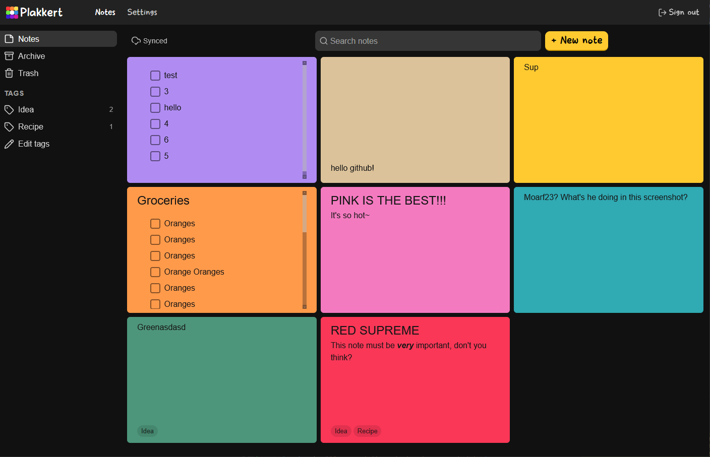

# Plakkert

A true end-to-end encrypted notes web app, built to work both offline & online.

**End-to-end encryption · Works offline · Sync across devices · Sharing (view or edit) · Tags · Archive · Trash · Drag & drop ordering · Multi-select · Hidden notes · Note history · Search · Ten colours · Checklists & code blocks · Google Keep import · Markdown export · Encrypted backups · MCP for AI assistants · Installable · Self-hostable · Invite-only sign-up · No email**

## Your notes are yours

Everything is encrypted in your browser before it leaves it, so the server only ever stores
ciphertext. That includes more than the text: tags, colours, whether a note is archived, even where
it sits in your order. Your password never leaves your device either.
[How encryption works](docs/encryption.md)

## No connection? No problem

Plakkert is an installable web app that keeps working offline. Create, edit, organise and search
your notes on the train or on a plane, and they sync when you're back online.

## Fast with thousands of notes

Measured with 1,000 notes, in Chrome on a desktop:

- **0.3 s** to open the app
- **1 request** to sync when nothing changed
- **~10 MB** of JavaScript memory

## Bring your notes, take them with you

Import everything from Google Keep in one go. Export to Markdown at any time, optionally in a
password-protected zip. Or make a backup, still encrypted, and restore it on this or any other
Plakkert server.

## Fully optional MCP support

Connect Claude, ChatGPT or any other MCP client, and choose for each one what it may read or
change. It's off unless you turn it on. [More about MCP](docs/mcp.md)

## Tested

Over 200 unit tests and 60 end-to-end tests run on every push. The end-to-end tests drive real
browsers against the production build, through offline use, syncing between devices and sharing
between users.

## Documentation

- [All features in detail](docs/features.md)
- [How encryption works](docs/encryption.md)
- [MCP](docs/mcp.md)
- [Self-hosting](docs/self-hosting.md): one Node.js server with SQLite, in a single container
- [Development](docs/development.md)

## License

[GNU AGPLv3](LICENSE) or later: free to use, change and share. If you run a changed version for
others, make its source available to them too.
